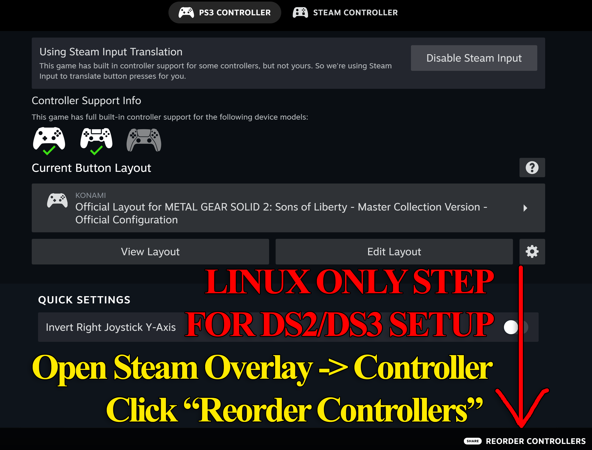
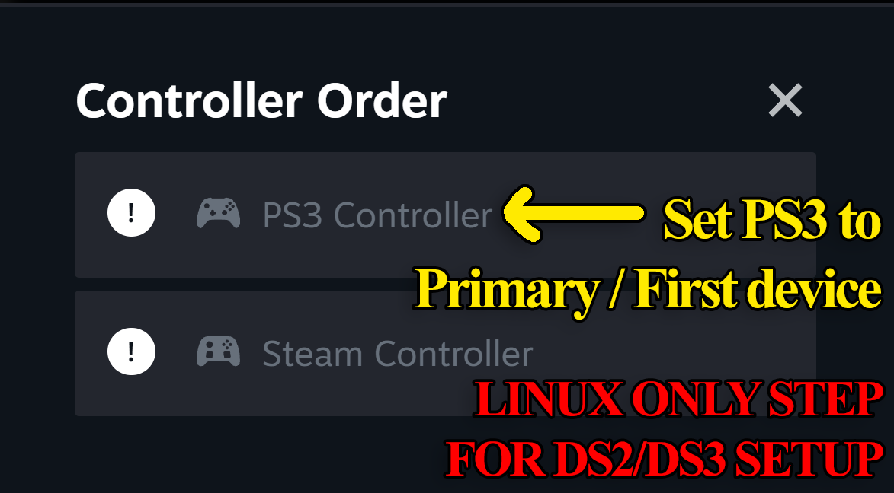
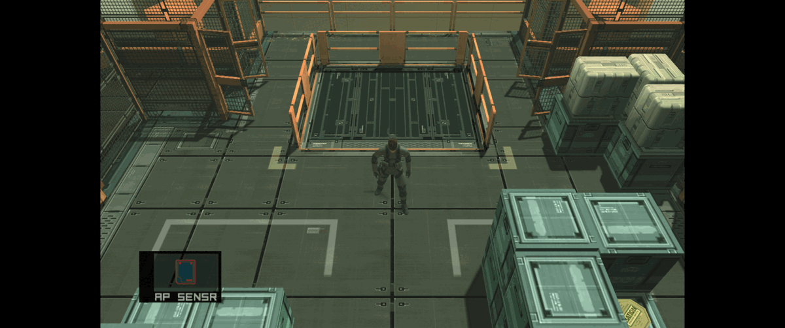
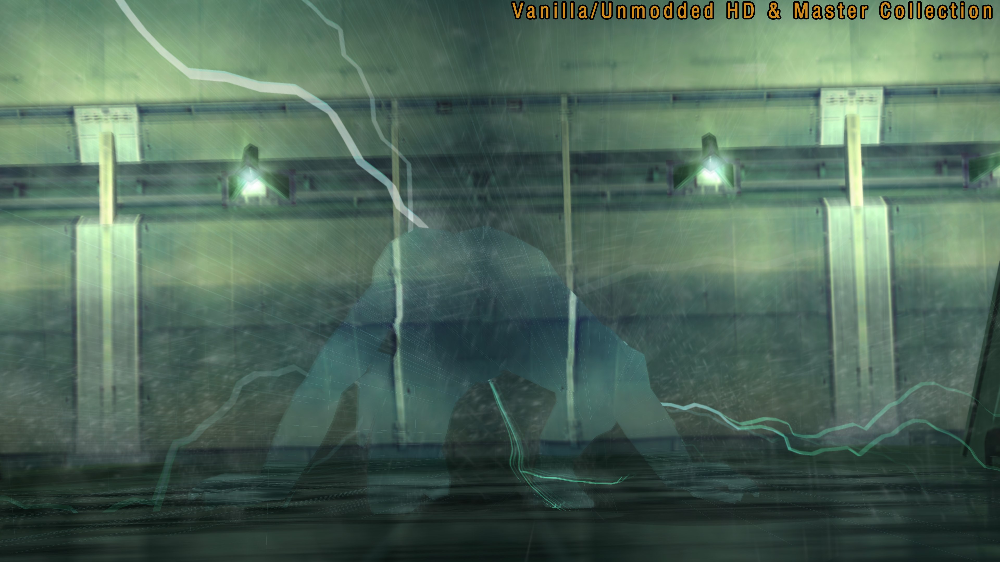
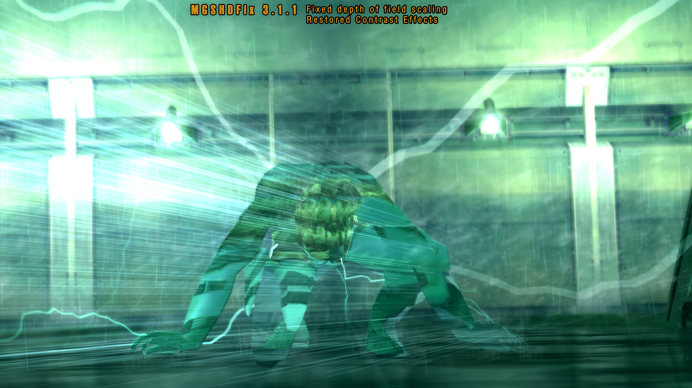

# MGSHDFix: Restoring MGS Master Collection Visuals & Stability 🎮

### ⌨️ PowerShell Command Button

  

---

This is the definitive fix for the Metal Gear Solid Master Collection, a passion project built to drag the PC ports kicking and screaming back to their former glory. It restores gutted visual effects, patches out hard crashes, and unlocks custom resolutions so the world can finally be seen in crisp, modern detail. Whether you're a tinkerer or a weary soldier returning to Shadow Moses, this mod was made for you. Dive into the config and see what a little bit of modding magic can do.

## ✅ Requirements

- **OS:** Windows 10 / 11
- **Shell:** PowerShell 5.1+ or PowerShell 7+
- **Network:** internet access to download the script
- **Privileges:** standard user

## Features

This is where the Master Collection gets dragged back toward the way it was always meant to look, play, and feel. Every fix here was born from staring at a broken effect, a vanished shadow, or a mid-cutscene crash and deciding the emulated-era version deserved better.

### Shared Engine Goodness

- **Custom resolutions & ultrawide support** so the world stretches past the edges instead of boxing you in.
- **Experimental 16:9 HUD option** that actually resizes the HUD and movies to match (MGS2/MGS3).
- **Borderless and windowed modes** for those who refuse to be held hostage by a single monitor.
- **DualShock 2 / 3 support**, pressure-sensitive face buttons and all, for that analog squeeze.
- **Swap X/O menu inputs** for anyone whose muscle memory refuses to be retrained.
- **Mouse cursor toggle**, because it should not hover over a tactical espionage operation.
- **Launcher skips**, configurable to your heart's content.
- **No pausing on alt-tab**, for the multitaskers and the alt-tab tourists.
- **Bilinear filtering off** for a crisp, pixel-art/retro look.
- **Raised texture size limits** (MG1/MG2/MGS3) so artists aren't boxed in by ancient ceilings.
- **Custom PS2-style controller glyphs** without stomping on your existing textures.
- **Aim after firing** toggle, so first-person shots don't leave you awkwardly lowering your gun.
- **Toggleable wireframe modes** for the tinkerers and the curious.
- **Forced highest-polygon models** during gameplay and cutscenes for maximum visual fidelity.
- **Intro logo skips**, because the mission briefing starts at the title screen.
- **Adjustable anisotropic filtering** (MGS2/MGS3) for ground textures that stay sharp.
- **Vanilla camera revert** option to undo the 2011 HD Collection's choreography changes.
- **Adjustable caption scale and opacity** for readable subtitles at any resolution.
- **Steam Achievement unlock disable** for speedrunners chasing clean splits.
- **SMAA anti-aliasing** support (MGS2/MGS3).
- **Gamma correction across all games**, restoring the vibrant colors and deep blacks a CRT would have served.
- **Developer-menu level select fast start** for MGS2 and MGS3, tucked into the internal tab.
- **Speedrunner in-game timer and stats overlay** for the stopwatch faithful.
- **Restored PS2 memory card strings, messages, and captions** to drag back the flavor text.
- **Restored flashing effects** (explosion flashes and kin) that the Master Collection censored for photosensitivity reasons.
- **Raw mouse input** for MGS2's Bluepoint third-person camera (mouse-wheel zoom included) and MGS3's third-person camera, with first-person still under the knife.

### Translation File Loading

- Replace all .SDT and .GCX text across every language without touching a single game file.
- Every game can load a dif.json file from its /translations folder.
- A companion string editor is on the way to help translators build out their work.

### MG / MG2 Specific Features

- **Custom Developer Menu** for stage select and item/equipment tweaking.
- **No health drain while smoking** (on by default, true to the original MSX2 behavior).
- **Overscan cropping** for the top and bottom borders.
- **Correct 4:3 aspect ratio** option, fixing the raw 64:53 output the MSX2 actually used.
- **.flac, .wav, .mp3, and .ogg audio replacement** support.
- **Vector .ttf text replacement** to wipe out the low-res text, with Latin and non-Japanese font support available for translation projects.
- **Automatic keycard checks on doors**, the way MGS1 and MGS2 handle them.
- **Original MSX2 boss names** restored.
- **In-game timer pause fix** for the pause screen and save/load menus.
- **MG2: Original character sprites and face animations** restored.
- **MG2: The censored sauna guard** reverted.
- **MG2: Medical symbols and intro cigarette packaging** reverted.
- **MG2: Retranslated MSX2 script**, English only for now, with a call out for translators on other languages.

### MGS2 Specific Features

- **Bluepoint's cancelled Subsistence-style third-person camera** unlocked.
- **Bluepoint's cancelled first-person shooter camera** unlocked.
- **2001 Japanese Sons of Liberty ringtone** restored.
- **PS2 Solidus choking durations, health loss/regain speed, and health reduction** restored to their original balance.
- **Sunglasses toggles** to force Snake/Raiden to wear them, or disable them outright.
- **Real Time Clock hostage Easter egg** reactivated.
- **Grenade cooking restored**, so the timer can start while still in hand.
- **Realtime thermal palette swapping** between Substance/vanilla, Sons of Liberty red-hot, Splinter Cell Blacklist, black hot, and white hot via Numpad 7.
- **Cut Metal Gear 2: Solid Snake Colonel sprites** returned to some late-game Codec calls.
- **Original 2001 radar rotation** restored.
- **BP_Asset / Manifest modloader support**.
- **Shell casings rendered at all distances**.
- **Shadow resolution that scales with game resolution** instead of being locked to PS2's 256x256.
- **Radar enabled in Snake Tales**.
- **Custom lifebar name** option.
- **Character-aware lifebar names**, the way MGS3 and MGS4 do it.
- **Sons of Liberty elevator glitch restored** for speedrunners practicing the old strats.
- **Punches against Vamp counted as non-lethal** instead of lethal.
- **Forced highest-quality NPC models** for every character on screen.
- **High Frequency blade usable anywhere**.
- **Load time reductions** via a prefetch system that loads assets from every connected room ahead of time (Preload Only keeps IGT clean; Full also shortens fades and skips the first area namecard, adjusting IGT accordingly).
- **Skippable Olga taunt, Stillman coolant tutorial, Raiden sword training, and ending**, with correctly adjusted in-game time.

### MGS3 Specific Features

- **Grass rendered at all distances**, so the jungle never thins out from a distance.
- **Mouse sensitivity adjustment** for fine-tuned camera control.

And this is only the surface of the stack. More fixes and features land in regular drops, so the changelist keeps growing whether or not this list keeps up with it.

## Installation

First things first: make sure the game isn't running. No, really — close the launcher, put the controller down, and let the title screen rest. MGSHDFix does its best work when nothing is holding the game's files hostage.

Grab the latest release package and drop its contents straight into the root folder where the game's executable lives. That's the same folder that already holds the game's own data — you'll know you're in the right place when you spot the familiar launch binaries sitting beside your newly deposited fix files. If you're ever unsure, the folder that opens when you right-click the game in your library and follow the path to its installed location is the one you want. No need to touch anything in your documents or save folders; everything this fix needs lives right beside the game itself.

Once the files are in place, you're already done with the heavy lifting. Launch the game the way you always do, and the fix will quietly introduce itself on the first run — spinning up any configuration it needs and leaving your existing settings untouched. If the game boots and the world suddenly looks sharper, wider, and a whole lot less broken, congratulations: the fix is live.

From here, a companion configuration tool becomes your new best friend. It's the panel where you can dial in custom resolutions, flip on ultrawide support, toggle the various restored effects, and tune everything else to taste. Poke around freely — you can't break anything that a quick reset won't undo, and half the fun of a fix like this is discovering which features you never knew the game was missing.

A couple of field notes from the modder's playbook: keep the fix files alongside the game across updates, since a fresh patch can sometimes tidy them away, and if you ever want to roll things back, simply removing the added files returns the game to its vanilla self. No registry spelunking, no lingering traces — clean as a codec call.

One last thing: back up your saves before tinkering with anything, because even seasoned operatives respect a good checkpoint. Now go on — the game's been waiting for you, and it's finally dressed for the occasion.

## 📸 Screenshot

## Compatibility

MGSHDFix is built to play nice with the rest of your load order — and to keep playing nice as the collection keeps evolving. If you're running the vanilla Master Collection with nothing else under the hood, you're in the clear: drop it in and go. If you're the type who stacks mods like a cardboard box tower, read on.

**Tested companions.** MGSHDFix is designed to coexist with visual restoration packs, texture replacers, translation mods, and audio replacement sets — the translation file loading and audio replacement systems were built specifically so your other mods don't have to fight over the same game files. Custom PS2 controller glyphs and font packs slot in without overwriting existing textures.

**Load order matters.** When in doubt, let MGSHDFix load first. It touches a lot of shared engine plumbing, and mods that hook into the same systems will behave better when the fix has already claimed its ground. Texture and asset swaps generally don't care about order.

**Known friction points.** If another mod rewrites the same engine functions MGSHDFix patches — particularly camera, rendering, or timing behaviors — you may get unexpected results. Try disabling one at a time to isolate. Overlay tools and framerate limiters occasionally conflict with borderless/windowed mode; toggle that option if you see flicker. And if you're using a launcher skip alongside another launcher mod, pick one — they'll step on each other.

**Version drift.** The Master Collection receives updates, and MGSHDFix keeps pace. If a game patch lands and something breaks, check for a fresh build before assuming incompatibility. Nightly builds may already have the answer.

**Not covered?** MG1/MG2, MGS2, and MGS3 are the supported titles — other entries in the collection aren't in scope here. Cross-platform notes and per-game quirks are worth a skim if you're on Linux or running through a compatibility layer.

Found a conflict we should know about? Reports are gold. The more detail you bring — mod names, versions, and what broke — the faster it gets sorted.

## Credits & License

None of this happens in a vacuum. MGSHDFix stands on a long line of tinkerers, reverse-engineers, and stubborn fans who refused to accept a broken port — and it keeps growing because people like you keep poking at it. Whether you've filed a single typo, traced a memory address at 3 AM, translated a menu into your language, or just taken the time to write up a clear bug report, you're part of the crew. Credit where it's due, and gratitude where it's earned.

Huge thanks to everyone who has contributed code, research, testing, translation work, bug reports, and documentation over the years — including the folks who dug through the PS2 originals to verify behavior, the community bugfix compilations that filled in gaps, and the speedrunners who stress-tested everything until it broke. Special appreciation goes out to the modders behind the companion fix projects for other entries in the collection, and to the translation volunteers helping make the games legible in more languages. A tip of the bandana to the Discord regulars who keep the troubleshooting channels alive.

As for the legal bit: MGSHDFix is distributed under the license declared in the repository. In plain terms — this is a fan-made, non-commercial preservation and enhancement project. It ships no game assets. It does not include, redistribute, or relicense any copyrighted Metal Gear material. All trademarks and game content remain the property of their respective owners. You need a legitimately purchased copy of the Metal Gear Solid Master Collection to use this fix, full stop. Do not bundle this with pirated game files, do not sell it, and do not pass it off as official. If you're building on it, respect the license terms in the repo, give credit back to the project, and keep the spirit of the thing intact: fix the games, don't break the trust.

If you contribute, your work is welcome — and your name belongs in the credits. Pull requests, translations, bug reports, and testing all count. Snake didn't do it alone, and neither do we.